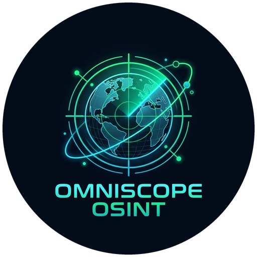

<div align="center">



# 🌐 OmniScope Web [OFFICIAL ORIGINAL]

[](https://github.com/finnytech/omniscope-web)
[](https://github.com/finnytech)
[](https://omniscope-web.pages.dev)
[](https://omniscope-web.vercel.app)
[](https://omniscope-web.vercel.app)
[](https://github.com/finnytech/omniscope-extension)
[](https://omniscope-web.fuchsdany1984.workers.dev/)
[](LICENSE)
[](CODE_OF_CONDUCT.md)
[](https://vercel.com/new/clone?repository-url=https%3A%2F%2Fgithub.com%2Ffinnytech%2Fomniscope-web)

</div>

> [!IMPORTANT]
> ### 🚨 OFFICIAL REPOSITORY & INTELLECTUAL PROPERTY NOTICE
> **OmniScope™ is the original, authentic open-source geospatial intelligence and tactical sensor grid created and maintained exclusively by [FinnyTech](https://github.com/finnytech).**
>
> ⚠️ **BEWARE OF UNAUTHORIZED CLONES & COPYCATS**:
> Following the recent viral surge of OmniScope, third parties (including unauthorized groups such as *"Sam Good Group / OmniScope Lite"*) have begun cloning, scraping, and republishing stripped-down knockoffs.
> 
> - **Canonical Live Web Dashboard (Cloudflare)**: [`https://omniscope-web.pages.dev`](https://omniscope-web.pages.dev)
> - **Canonical Live Web Dashboard (Vercel)**: [`https://omniscope-web.vercel.app`](https://omniscope-web.vercel.app)
> - **Official Web Repository**: [`https://github.com/finnytech/omniscope-web`](https://github.com/finnytech/omniscope-web)
> - **Official Chrome Side Panel Extension**: [`https://github.com/finnytech/omniscope-extension`](https://github.com/finnytech/omniscope-extension)
> - **Official OSINT Native Desktop Repository**: [`https://github.com/finnytech/omniscope-osint`](https://github.com/finnytech/omniscope-osint)
> - **Official Standalone MCP Suite**: [`https://github.com/finnytech/omniscope-mcp`](https://github.com/finnytech/omniscope-mcp)
> 
> Any versions hosted outside `*.pages.dev`, `omniscope-web.vercel.app`, or `github.com/finnytech/*` are unauthorized copies, lack our certified 147-model keyless consensus and Cloudflare Edge WAF security, and may contain modified or malicious code.

> **Serverless, 100% Free Open Geospatial Intelligence Dashboard for Cloudflare Pages & Vercel**  
> *Zero Server Costs • Zero Database Fees • 100% Keyless • Pure Open Data*

---

## 🧩 NEW: OmniScope OSINT Chrome Side Panel Extension (`v2.6.0`)

Monitor live Doppler radar, 4-model ensemble consensus, Sector Box-Scan weather stations, NOAA Tornado Alerts, USGS M2.5+ Earthquakes, 3-Axis Fluxgate Magnetometer Oscilloscope, and 56 verified webcams directly inside your **Chrome / Brave / Edge Side Panel**!

👉 **Official Chrome Extension Repository & 30-Second Setup Guide**: [**`https://github.com/finnytech/omniscope-extension`**](https://github.com/finnytech/omniscope-extension)

---

## ⚡ Overview

**OmniScope Web** is the free, client-side web edition of OmniScope OSINT. Designed specifically for modern edge platforms like **Cloudflare Pages** and **Vercel**, it requires **zero backend servers**, **zero cloud databases**, and **zero paid API keys**.

All live data is fetched directly inside the user's browser using open, CORS-enabled endpoints and bundled datasets:
- **Real-Time Doppler Radar**: Live precipitation loops via the RainViewer global composite API + NOAA NEXRAD.
- **Sector Bounding-Box Station Scanner (`📐 Sector Scan`)**: Click and drag a rectangle anywhere on the map to sample live multi-point station grids.
- **Global Earthquakes**: Real-time tectonic activity via official USGS GeoJSON feeds.
- **Meteorological Supercomputers**: Live temperature, pressure, CAPE, and dew point feeds via Open-Meteo (147 models).
- **3-Axis Geomagnetic & VLF Lightning Observatory**: Real-time 3-axis magnetometer oscilloscope + live local atmospheric weather companion.
- **Historical Weather & Tornado Outbreak Archive (`1940–Present`)**: Full ECMWF ERA5 historical reanalysis and NOAA storm archive.
- **Curated Worldwide Webcams**: Verified public live weather and Earth observation webcams loaded from `data/webcams.json`.
- **ISS Space Station Orbit**: Real-time orbital telemetry tracking.

---

## 🤖 Model Context Protocol (MCP) & Edge REST APIs

OmniScope features a dedicated, standalone repository for its complete Model Context Protocol ecosystem:  
👉 **Official Standalone MCP Repository**: [`https://github.com/finnytech/omniscope-mcp`](https://github.com/finnytech/omniscope-mcp)

OmniScope Web provides a native, zero-key Model Context Protocol (MCP) server and public Edge REST API suite hosted across Cloudflare's Anycast Edge for Claude Desktop, Cursor, and autonomous AI agents:

### 1. Stdio MCP Server (`omniscope-web-mcp`):
Add to `claude_desktop_config.json` or `.cursor/mcp.json`:
```json
{
  "mcpServers": {
    "omniscope-web": {
      "command": "node",
      "args": ["<PATH_TO_OMNISCOPE_WEB>/mcp-server/index.js"]
    }
  }
}
```
> 💡 *Replace `<PATH_TO_OMNISCOPE_WEB>` with the directory where you cloned this repository (e.g. `/home/user/omniscope-web` or `D:/projects/omniscope-web`).*


### 2. Live Cloudflare Anycast Remote MCP Endpoints:
- **Discovery Manifest**: [`https://omniscope-web.pages.dev/.well-known/mcp.json`](https://omniscope-web.pages.dev/.well-known/mcp.json)
- **JSON-RPC 2.0 Messages**: `https://omniscope-web.pages.dev/mcp/messages`
- **SSE Stream**: `https://omniscope-web.pages.dev/mcp/sse`
- **OpenAPI 3.1 Spec**: [`https://omniscope-web.pages.dev/openapi.json`](https://omniscope-web.pages.dev/openapi.json)
- **LLM Specification**: [`https://omniscope-web.pages.dev/llms.txt`](https://omniscope-web.pages.dev/llms.txt)

### 3. Public Keyless Edge APIs (`/api/*`):
- `GET /api/capabilities`: System health, capabilities, and Zero-Fake compliance.
- `GET /api/weather?latitude=50.11&longitude=8.68`: 147-model numerical consensus across DWD ICON, ECMWF IFS, NOAA GFS, and GEM Global.
- `GET /api/storms`: Active NOAA NWS tornado warnings and convective storm alerts.
- `GET /api/seismic?min_magnitude=2.5`: Real-time tectonic earthquake telemetry from USGS.
- `GET /api/space-weather`: Planetary Kp-index and geomagnetic storm threat levels from NOAA SWPC.
- `GET /api/webcams?query=zugspitze`: Search verified public streaming webcams.
- `GET /api/sitrep?location=Frankfurt`: Synthesize a comprehensive tactical Situation Report combining all live telemetry.

---

## 🌐 Official OmniScope Ecosystem & Sister Repositories

| Target / Platform | Link | Description |
| :--- | :--- | :--- |
| **🌐 Web HUD (Cloudflare Pages)** | [`https://omniscope-web.pages.dev`](https://omniscope-web.pages.dev) | Primary global Anycast Edge Web Command Center. |
| **▲ Web HUD (Vercel Production)** | [`https://omniscope-web.vercel.app`](https://omniscope-web.vercel.app) | High-speed Vercel global production mirror. |
| **🧩 Chrome Side Panel Extension** | [`github.com/finnytech/omniscope-extension`](https://github.com/finnytech/omniscope-extension) | Official Manifest V3 Chrome / Brave / Edge Side Panel Extension (`v2.6.0`). |
| **💻 OmniScope Web Repo** | [`github.com/finnytech/omniscope-web`](https://github.com/finnytech/omniscope-web) | Official Web Application & Edge Worker source code. |
| **🛰️ OmniScope OSINT Repo** | [`github.com/finnytech/omniscope-osint`](https://github.com/finnytech/omniscope-osint) | Native Python FastAPI + SQLite Spatial DB + Desktop/Mobile hub. |
| **🤖 OmniScope MCP Repo** | [`github.com/finnytech/omniscope-mcp`](https://github.com/finnytech/omniscope-mcp) | Standalone Model Context Protocol (MCP) server for AI agents. |

---

## 🛡️ Zero-Fake Policy

Across all editions, OmniScope enforces a strict **Zero-Fake Policy**:
- **Meteorological Data Integrity**: Strict scientific distinction between radar-detected cloud rotation (`RADAR INDICATED`) and ground-verified tornadoes (`OBSERVED GROUND CONTACT`).
- **No Speculative EF Ratings**: The Enhanced Fujita (EF) scale is assigned exclusively following official NWS ground damage surveys. Live warnings never receive speculative ratings or fabricated wind speeds.
- **Client-Side Transparency**: Any feature requiring private authentication is transparently omitted in keyless mode rather than simulating synthetic dummy data.
- **100% Genuine Open Data**: Every telemetry feed originates from unmodified, verified real-time endpoints provided by NOAA/NWS, RainViewer, USGS, and Open-Meteo.

---

## 📚 Attributions & Credits

- **Weather Consensus**: Meteorological models provided by [Open-Meteo.com](https://open-meteo.com/) under [CC BY 4.0](https://creativecommons.org/licenses/by/4.0/).
- **Precipitation Radar**: Live composite Doppler tiles provided by [RainViewer.com](https://www.rainviewer.com/).
- **Earthquake Feeds**: Global seismic telemetry provided by the [United States Geological Survey (USGS)](https://earthquake.usgs.gov/).
- **Orbital Space Tracking**: Real-time trajectories via WhereTheISS and Open-Notify.

---

## 📄 License

Distributed under the **MIT License**.
