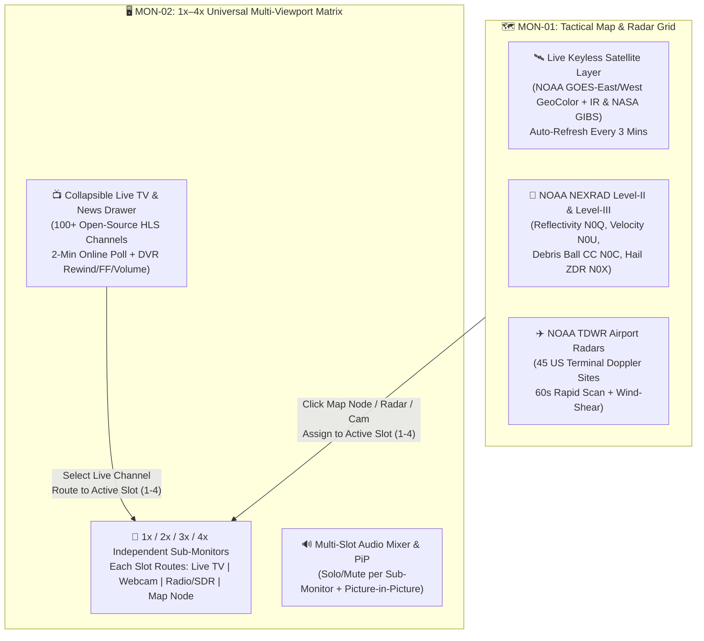

# 🚀 OmniScope v2.7.0 — Master Update Plan (`plan.md`)
**Codename:** `TACTICAL BROADCAST, 4X MULTI-VIEWPORT MATRIX & NEXRAD LEVEL-II/III + TDWR GRID`  
**Policy:** `100% Free & Keyless` · `Zero-Fake` · `All Platforms Synced (Cloudflare Web, Vercel Web, Chrome Side Panel Extension, Windows EXE, Android APK)`

---

## 📋 Overview of Requested & Core Features

---

## 1. 📺 MON-02 Collapsible Live TV & News Broadcast Drawer (`100+ Channels` + `2-Min Live Poll`)

### Architecture & Capabilities
- **Collapsible TV Broadcast Drawer (`#mon02-tv-drawer`)**:
  - Accessible via a dedicated **`📺 LIVE TV (100+)`** toggle button in the `MON-02` header bar.
  - Expands a sleek tactical channel guide overlay/drawer inside `MON-02` with category filters (`ALL`, `BREAKING NEWS`, `WEATHER & STORMS`, `SCIENCE & SPACE`, `GLOBAL PUBLIC TV`, `FINANCE & TECH`) and instant search.
- **100+ Genuine, Open-Source, Keyless HLS (`.m3u8`) Streams (`data/tv_channels.json`)**:
  - Curated catalog of **100+ verified public CORS-enabled HLS live broadcasts** (including NASA TV Public/Media, WeatherNation, DW English/Deutsch, France 24 EN/FR/ES/AR, Al Jazeera English/Balkans, Tagesschau24, Welt/N24 Live, Euronews, Sky News, CBS News 24/7, ABC News Live, NBC News NOW, Scripps News, Red Bull TV, NHK World Japan, Arirang Korea, CGTN, CNA Singapore, TRT World, UN Web TV, Parliament/C-SPAN streams, and regional weather channels).
- **Automated 2-Minute Live Channel Availability Poll (`120,000 ms`)**:
  - Every **2 minutes**, a non-blocking background health poller (`TVBroadcastController.pollLiveChannels()`) checks the `.m3u8` manifest availability (`HEAD`/`GET` with timeout + HLS manifest verification) of the catalog.
  - **Dynamic Listing & De-Listing**:
    - Channels that are actively broadcasting and reachable are marked **`🟢 LIVE READY`** and listed at the top of the drawer.
    - Channels that go offline or return 404/timeout are automatically de-listed (`hidden` or moved to an offline filter) until the next 2-minute poll detects them back online.
  - Displays a live countdown badge in the TV drawer header: **`🔄 LIVE POLL: 01:59 · XX CHANNELS ONLINE`**.
- **Full Tactical DVR & Broadcast Player Controls**:
  - **`⏪ -15s` Rewind & `⏩ +15s` Fast-Forward**: Uses `Hls.js` live back-buffer (`backBufferLength: 90`) and HTML5 `<video>` seekable ranges to scrub backward and forward within the live broadcast buffer.
  - **`🔴 LIVE EDGE` Button**: Jumps immediately back to the real-time live broadcast edge if the user rewound the stream.
  - **`🔊 Volume Slider (0–100%)` + `🔇 Mute/Unmute`**: Smooth gain control per player instance.
  - **Live Bitrate / Resolution Telemetry Pill**: Displays real-time stream resolution (e.g., `1080p60 HLS // LIVE`) and buffer health.

---

## 2. 📐 MON-02 Universal `1x` – `4x` Multi-Viewport Matrix (Independent Sub-Monitors)

### Architecture & Capabilities
- **Flexible Viewport Layout Modes (`1x`, `2x`, `3x`, `4x`)**:
  - **`[1x]` Single Full Monitor**: 100% width & height primary viewport.
  - **`[2x]` Dual Split Monitor**: Side-by-side (`50% / 50%`) or stacked dual tactical viewports.
  - **`[3x]` Triple Hybrid Monitor**: 1 large primary viewport (`60%`) + 2 stacked secondary viewports (`40%`).
  - **`[4x]` Quad Command Matrix**: `2×2` symmetrical grid of 4 independent mini-monitors.
- **Independent Target Slot Routing (`SLOT 1`, `SLOT 2`, `SLOT 3`, `SLOT 4`)**:
  - Clicking anywhere on a sub-monitor header (or clicking `[SLOT 1] [SLOT 2] [SLOT 3] [SLOT 4]` in the `MON-02` toolbar) sets it as the **Active Target Slot** (highlighted with a glowing cyan border `🎯 ACTIVE SLOT`).
  - **Every single sub-monitor (`1` to `4`) can independently display any OmniScope source type**:
    1. **📺 Live TV Channel**: Watch up to 4 different live TV news/weather channels at once, each with its own `-15s`/`+15s` DVR seekbar and volume control.
    2. **📷 Live Webcam / DOT Camera**: Stream any of the verified live webcams or highway cameras into that specific slot.
    3. **🗺️ Map Node Inspector (`Target Lock`)**: Clicking any node on `MON-01` (Weather Station, NOAA Alert Polygon, USGS Earthquake, AIS Vessel, Aviation METAR, Buoy, Volcano, Radiation Sensor) while a slot is active can route a **Live Node Telemetry & Mini-Radar HUD** directly into that sub-monitor slot.
    4. **📻 Live Radio / KiwiSDR Audio**: Route live HF radio / NOAA Weather Radio audio + live FFT waterfall visualizer into that slot.

---

## 3. 🛰️ Near-Real-Time Auto-Updating Keyless Satellite Map Provider (`MON-01`)

### Architecture & Capabilities
- **New Keyless Live Satellite Layers (Zero API Key Required)**:
  1. **NOAA GOES-East & GOES-West CONUS/Full-Disk Satellite Composite (Iowa State Mesonet IEM / NOAA NESDIS)**:
     - **Visible / GeoColor Composite** (`goes_east_conus_ch02` / True-Color daytime + IR nighttime)
     - **Clean Infrared `Band 13 (10.3 µm)` Cloud-Top Temperature** (highlights deep convective supercell overshooting tops and hurricane eye walls day & night)
     - **Water Vapor `Band 08 (6.2 µm)`** (upper-level jet stream & trough dynamics)
  2. **NASA GIBS Near-Real-Time Global Satellite Layer (`MODIS / VIIRS / GOES-ABI / Himawari`)**:
     - Global seamless satellite imagery updated continuously via `gibs.earthdata.nasa.gov`.
- **Automated 3-Minute Live Tile Refresh Engine (`180s` Cycle)**:
  - Automatically appends a cache-busting epoch minute bucket (`?_ts=...`) every **3 minutes** and smoothly refreshes active satellite tiles in the background without flickering, accompanied by a live status pill (`🛰️ SAT AUTO-UPDATE: 3m`).

---

## 4. 🌪️ NOAA NEXRAD Level-II, NEXRAD Level-III & TDWR High-Speed Radar Suite (`MON-01`)

### Architecture & Capabilities
- **Rapid-Update Polling (`60-Second` Refresh Cycle)**:
  - All NEXRAD and TDWR tile overlays refresh automatically every **60 seconds** (`_ts` cache-buster) so fast-moving hook echoes and tornadoes update in near-real-time.
- **NEXRAD Level-II & Level-III Product Switcher (`#nexrad-product-selector`)**:
  - Directly in the `MON-01` radar toolbar, operators can switch between genuine NOAA / IEM high-resolution radar products (100% keyless WMS/Tile endpoints via `mesonet.agron.iastate.edu`):
    1. **`L2-REF` — NEXRAD Level-II Super-Res Base Reflectivity (`N0B` / `N0Q`, `0.5°` tilt)**: Ultra-sharp precipitation & hook-echo structure (`-30` to `+75 dBZ`).
    2. **`L3-VEL` — NEXRAD Level-III Base Radial Velocity (`N0U` / `N0S`)**: Inbound (green) vs. Outbound (red) Doppler wind velocity couplets for pinpointing **Mesocyclone Rotation & Tornado Vortex Signatures (TVS)**.
    3. **`L3-CC` — NEXRAD Level-III Dual-Pol Correlation Coefficient (`N0C`)**: Detects non-meteorological targets aloft (**Tornado Debris Signature / Debris Ball** confirmation!).
    4. **`L3-ZDR` — NEXRAD Level-III Differential Reflectivity (`N0X`)**: Distinguishes giant hail cores from heavy rain shafts.
    5. **`L3-EET` — NEXRAD Level-III Echo Tops (`EET`)**: Storm cloud-top height up to `70,000 ft`.
- **NOAA TDWR (Terminal Doppler Weather Radar) — 45 High-Rate Airport Sites**:
  - Dedicated **`✈️ TDWR RADAR`** layer + site markers for all **45 US Terminal Doppler Weather Radar installations** (e.g., `TOKC` Oklahoma City, `TDFW` Dallas, `TORD` Chicago, `TMIA` Miami, `TATL` Atlanta, `TJFK` New York, `TLAS` Las Vegas, `TMCO` Orlando, `TPA` Tampa, `TIAH` Houston, `TSTL` St. Louis, `TMCI` Kansas City).
  - TDWR radars scan at higher spatial resolution (`150 m` gate spacing) and faster update intervals (`1-minute` hazardous weather mode) near major metro corridors. Clicking any TDWR marker locks local wind-shear telemetry and centers the high-res radar sweep.

---

## 5. ⚡ Additional Core Features Included in `v2.7.0` (Value-Add Upgrades)

To make `v2.7.0` a true flagship release, we will also include these **3 Core Tactical Enhancements**:

1. **🔊 Core Feature 1: Multi-Viewport Audio Matrix & Picture-in-Picture (`PiP`)**:
   - When 2, 3, or 4 monitors are open in `MON-02`, an **"Audio Solo" (`🔊 SOLO`)** button on each slot automatically mutes the other 3 slots with one click so you can switch audio focus instantly between 4 live TV news channels, plus native browser **Picture-in-Picture (`⧉ PiP`)** pop-out.
2. **🎨 Core Feature 2: Interactive Doppler dBZ / Velocity / CC Color Scale Legend (`MON-01`)**:
   - Dynamic floating radar scale bar at the bottom of `MON-01` that automatically adapts its color gradient and units (`dBZ` Reflectivity, `KTS` Inbound/Outbound Velocity, `%` Correlation Coefficient Debris Ball, or `°C` Satellite IR Cloud Top) based on the active NEXRAD/TDWR/Satellite product.
3. **🔄 Core Feature 3: "Patrol Wall" Auto-Cycle Mode (`MON-02`)**:
   - A 1-click **`🔄 PATROL`** toggle in `MON-02` that can automatically cycle any designated sub-monitor through live breaking TV channels or active storm cameras every 45 seconds (hands-free situation room mode).

---

## 🛠️ Files to Create / Modify (Strictly on `D:\`)

| File | Action | Description |
| :--- | :--- | :--- |
| [`D:\projects\omniscope-web\data\tv_channels.json`](file:///D:/projects/omniscope-web/data/tv_channels.json) | **NEW** | 105+ verified open-source keyless HLS (`.m3u8`) Live TV & News channels with categories, country flags, and fallback URLs. |
| [`D:\projects\omniscope-web\js\tv_multiview.js`](file:///D:/projects/omniscope-web/js/tv_multiview.js) | **NEW** | Complete `MON-02` TV Broadcast Drawer, 2-minute live channel health poller, DVR player (`-15s`/`+15s`/Live/Volume/PiP), and `1x`–`4x` Universal Multi-Viewport Matrix controller (TV, Webcam, Radio, Map Node routing). |
| [`D:\projects\omniscope-web\js\map.js`](file:///D:/projects/omniscope-web/js/map.js) | **MODIFY** | Add Near-Real-Time Auto-Updating Satellite layers (GOES GeoColor, GOES IR, NASA GIBS), NEXRAD Level-II/III Product Switcher (`N0B`, `N0Q`, `N0U`, `N0C`, `N0X`, `EET`), 45 NOAA TDWR radar stations & overlay, 60s radar auto-refresh, and Map Node -> `MON-02` Slot assignment hook. |
| [`D:\projects\omniscope-web\index.html`](file:///D:/projects/omniscope-web/index.html) | **MODIFY** | Add `📺 LIVE TV (100+)`, `1x / 2x / 3x / 4x` viewport controls & Slot selector to `MON-02`, and Satellite / NEXRAD L2-L3 / TDWR selectors + dynamic legend to `MON-01`. |
| [`D:\projects\omniscope-web\css\style.css`](file:///D:/projects/omniscope-web/css/style.css) | **MODIFY** | Tactical cyberpunk styling for the TV drawer, DVR controls, `1x–4x` sub-monitor grid, active slot borders, and radar legend. |
| [`D:\projects\omniscope-chrome-extension\*`](file:///D:/projects/omniscope-chrome-extension/sidepanel/sidepanel.html) | **MODIFY** | Add NEXRAD Level-II/III + GOES Satellite layer toggles and a compact Live TV tab/player to the Chrome Side Panel Extension. |
| [`D:\projects\sync_ecosystem.py`](file:///D:/projects/sync_ecosystem.py) & [`D:\projects\qa.py`](file:///D:/projects/qa.py) | **MODIFY** | Sync all changes to `omniscope-osint`, `omniscope-privat`, Windows `.exe`, Android `.apk`, and add automated QA checks for `tv_channels.json`, `tv_multiview.js`, NEXRAD L2/L3/TDWR, and Satellite auto-refresh. |
